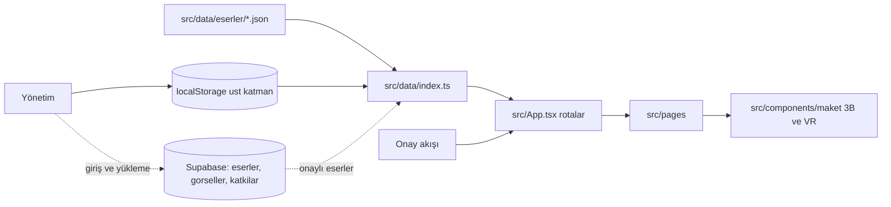
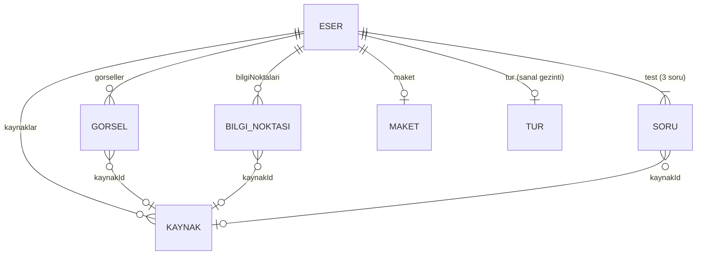

# KökXR

Bursa'daki vakıf eserlerini dijital olarak keşfetmeye yönelik bir KÖK&KOD hackathon prototipi: eser seçimi, fotoğraf galerisi, bilgi paneli, üç soruluk test, temsilî 3B maket ve WebXR (Quest tarayıcısı), vazo/kılıç/çini atölyeleri, yönetim ve onay akışı.

> Tarihsel metinlerin bir kısmı kitapla karşılaştırılmadı; her eserde "Kaynaklı bilgi" veya "Temsili içerik" etiketi görünür. Verisi olmayan özellik varmış gibi gösterilmez.

## Kurulum ve çalıştırma

Node.js 24+ gerekir (`.nvmrc`).

```bash
nvm use 24
npm install
npm run dev          # geliştirme sunucusu
npm run build        # üretim derlemesi (dist/)
npm run preview      # derlenmiş sürüm, varsayılan 4173
```

İsteğe bağlı bulut kaydı için `.env` dosyasına `VITE_SUPABASE_URL` ve `VITE_SUPABASE_ANON_KEY` yazılır (dosya git'e girmez). `.env` yoksa uygulama yalnız tarayıcıdaki `localStorage` ile çalışır. Tabloları kurmak için `supabase/sema.sql` Supabase SQL Editor'de bir kez çalıştırılır; dosyanın sonunda yönetici atama satırı vardır.

## Testler

| Komut | Ne yapar |
|---|---|
| `npm run test:hizli` | Tip denetimi + saf testler (saniyeler) |
| `npm run test:tarayici` | Build + preview + tarayıcı testleri; tek test için `node scripts/test-tarayici.mjs yonetim` |
| `npm run test:e2e` | Uçtan uca, 3 yapılandırma (ayrı terminalde `npm run preview` açık olmalı); başarısız adımda çıkış kodu 1 |

Yazılımsal çizimle yerel testler yavaştır; FPS yalnız gerçek cihazda ölçülür.

## Mimari



Ayrıntılı klasör haritası: `docs/HARITA.md`; durum ve plan: `docs/DURUM.md`.

## Veri modeli



Tipler: `src/types/eser.ts`. Bulutta `eserler(id, veri jsonb, durum)`, `gorseller(eser_id, yol, alt, kredi)`, `katkilar`; durum `beklemede | onaylandi | reddedildi` ve yalnız onaylanan yayında.

## Yeni eser ekleme

- **Arayüzden:** `/yonetim/yeni` formu; kayıt önce "beklemede" kalır, `/onay` sayfasında onaylanınca yayına girer.
- **Koddan:** `src/data/eserler/<eser-id>.json` ekleyin (otomatik yüklenir). Bilinmeyen alanı uydurmayın, boş bırakın. `dogrulama: "dogrulanmis"` yalnız kaynaklı bilgiye verilir.
- **3B maket:** `src/components/maket/yapilar/<eser-id>.ts` içinde `export const yapi = (): Maket => ...`.

## Yeni şehir ekleme

`src/data/vrEserler.ts` içindeki `vrSehirler` listesine `{ ad, konum: [boylam, enlem], yapilar, yayinlar }` ekleyin; eser JSON'larında `sehir` aynı adı taşımalıdır. Ana sayfanın şehir süzgeci eser verisinden kendiliğinden dolar. VR girişi yalnız eserde `maket` veya `restorasyon` varsa açılır.

## Erişilebilirlik

Üst çubukta yazı boyutu (A−/A+) ve yüksek kontrast düğmeleri; eser sayfasında tarihçe için tarayıcının sesli okuyucusuyla "Sesli dinle". Ayarlar `localStorage`'da kalır.

## Kütüphaneler ve lisanslar

| Paket | Kullanım | Lisans |
|---|---|---|
| React, React DOM, React Router | Arayüz ve rotalar | MIT |
| Three.js | 3B maket ve WebXR | MIT |
| @supabase/supabase-js | İsteğe bağlı bulut kaydı, giriş, yükleme | MIT |
| Vite, TypeScript, Playwright (geliştirme) | Derleme, tip denetimi, testler | MIT / Apache-2.0 |

Lisanslar paketlerin kendi `LICENSE` dosyalarından teyit edilmelidir. Türkiye sınır çizgisi Natural Earth verisidir (kamu malı). Üçüncü taraf 360° gezinti `360tr.com` gömmesidir.

## Fotoğraf kredisi

Her görselin `kredi` alanı vardır ve görselin altında gösterilir:

> Fotoğraf: Vakıf Katılım, Vakıf Eserleri Envanter Projesi – Bursa Fotoğraf Arşivi

Repo private kalır; izni netleşmemiş fotoğraflar herkese açık yayımlanmaz (`npm run build:acik` fotoğrafsız sürüm üretir).
