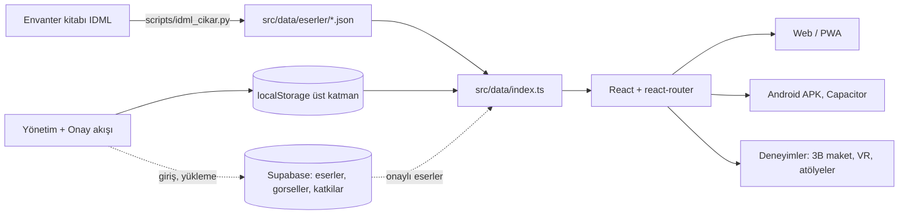

# Final sunum taslağı (şartname 5.4 sırası)

Sunumu yalnız takım üyeleri yapar. Süre ve şablon finalistlere ayrıca bildirilecek; aşağıdaki slaytlar süreye göre kısaltılır. Sayılar 2026-11-07 itibarıyla depodan alınmıştır, sunumdan önce yeniden sayın (`ls src/data/eserler | wc -l`).

**Kural:** Slaytta yalnız "Çalışıyor" bölümündeki şeyler anlatılır. "Vizyon" bölümü ayrı bir slayttır ve "henüz uygulanmadı" etiketiyle gösterilir.

## Slaytlar

### 1. Problem
- Vakıf eserleri ders kitabı fotoğraflarından ve vitrinlerden tanınıyor; kaynaklı, kolay ulaşılır bir dijital kapı yok.
- Elimizdeki gerçek veri: Vakıf Katılım Vakıf Eserleri Envanteri – Bursa kitabı ve fotoğraf arşivi.
- Slayta Şanlıurfa girmez.

### 2. Hedef kullanıcı
- Öğrenci ve öğretmen (eser sayfası, üç soruluk test, Öğretmen paneli: örnek veriyle etiketli).
- Meraklı gezgin (harita, hazır rotalar, sesli anlatım).
- İçerik küratörü (yönetim ekranı ve onay akışı).

### 3. Çözüm
KökXR: kaynaklı eser sayfaları, galeri, bilgi noktaları, test, harita ve rota; web/mobil ana akış. VR, atölyeler ve Öğretmen "Deneyimler" altında.

### 4. Canlı demo
`docs/demo-senaryosu.md` dakika dakika izlenir. Yedek: `npm run demo` (wifi olmadan yerel). Quest adımı gerçek cihaz ister.

### 5. Mimari ve veri modeli
README'deki iki şema kullanılır (`README.md` "Mimari", "Veri modeli"):

Not: Supabase tabloları henüz kurulu değilse uygulama yerel kayıtla çalışır (`docs/supabase-kurulum.md`). APK'nın derlenmiş hâli yoktur, yalnız iskelet hazır (`docs/apk.md`).

### 6. Veri kullanımı
- 14 Bursa eseri; her biri kaynak satırı (kitap, sayfa) ve doğrulama etiketi taşır.
- 85 fotoğraf kaydı (kredi alanıyla), 42 test sorusu. Yeni eklenen 4 eserin fotoğrafı yok (izin ve boyut nedeniyle).
- Veri hattı: IDML → düz metin → eser JSON'u → doğrulama (`src/data/dogrulama.ts`) → onay → yayın.
- Doğrulama durumu: `docs/dogrulama-raporu.md` (yalnız sayı karşılaştırması; tam okuma yapılmadı, bunu söyleyin).
- Harita işaretleri doğrulanmış koordinat gelene kadar yok; rotalar liste olarak çalışır.

### 7. Yenilik
- Kaynaklı bilgi + "doğrulanmadı" rozeti: uydurma yok, etiketsiz bilgi yok.
- Topluluk katkısı moderasyonla; onaylanmayan yayına girmez.
- Tarayıcıda 3B maket ve WebXR; sesli anlatım, yüksek kontrast, yazı boyutu.
- Kılıç atölyesi: Bursa vakıf eseri değildir, ek deneyim olarak "Deneyimler" altında. Bunu kendimiz söyleriz.

### 8. Ölçek
- Mimari: yeni şehir ve yapı türü kod değişmeden süzgeçlere gelir (`tests/yonetim.mjs` Konya/Meram/Han denemesi test verisidir).
- Gerçek Konya ve Hatay verisi yok: kitap dosyaları elle indirilecek (`docs/FINAL_PLANI.md`, G7). "Ölçeklenebilir" diyebiliriz, "Konya'da çalışıyor" diyemeyiz.
- Sıra: Bursa → Konya → Hatay.

### 9. Yol haritası
Supabase'in kurulumu, APK derlemesi, fotoğraf izinleri, koordinat doğrulaması, Konya/Hatay verisi, erişilebilirlik için axe/Lighthouse ölçümü (henüz yapılmadı).

### 10. Ekip
Muhammet Ali Divan (kaptan), İsmet Bayandur, Selami Ali Şimşek, Meltem Taşkın. Görev dağılımı: `docs/gorev_dagilimi.md`. Herkes kendi kısmını ve mimariyi 1 dakikada anlatabilmeli (şartname 5.2.3).

## Çalışan vaatler ve vizyon

| Çalışıyor (gösterilebilir) | Vizyon (henüz uygulanmadı, ayrı slayt) |
|---|---|
| Eser sayfası, galeri, kaynak, test | Eserin 1:1 dijital ikizi, "Dokunulabilir Müze" |
| Süzgeç, harita sayfası, rotalar | AR (telefon/tablet) |
| Yönetim, onay, topluluk katkısı | KökMobil (gezici VR sınıfı) |
| PWA, çevrimdışı açılış | Akademisyen onaylı ulusal Dijital Miras Kütüphanesi |
| 3B maket, VR (Quest'te denenmeli) | Konya ve Hatay verisi |
| Sesli dinleme, erişilebilirlik araçları | Yapay zekâsız "motife işaret et" ile tüm eserler (yalnız verisi olanlarda) |

`docs/sunum-vaatleri.md` eski metindir; içindeki Şanlıurfa ve "her cihaz" anlatısı bu taslakta kullanılmaz.

## Sunumdan önce doğrulanacaklar
- Quest'te VR akışları gerçek cihazda denendi mi?
- kokxr.vercel.app başka ekip üyesinin hesabında; güncel sürüm orada mı?
- Fotoğraf izinleri ve 360TR gömme izni (`docs/lisanslar.md`).
